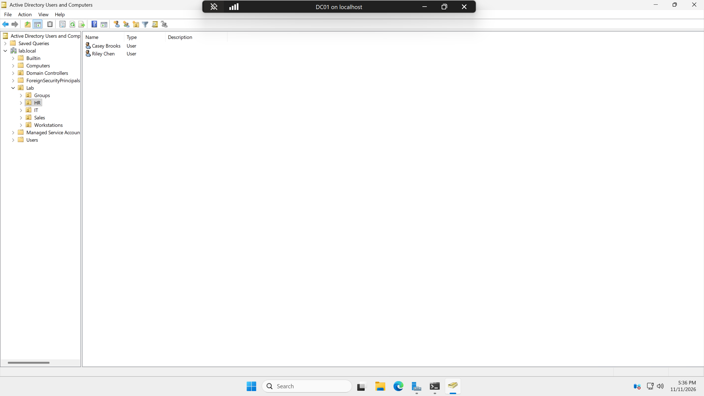
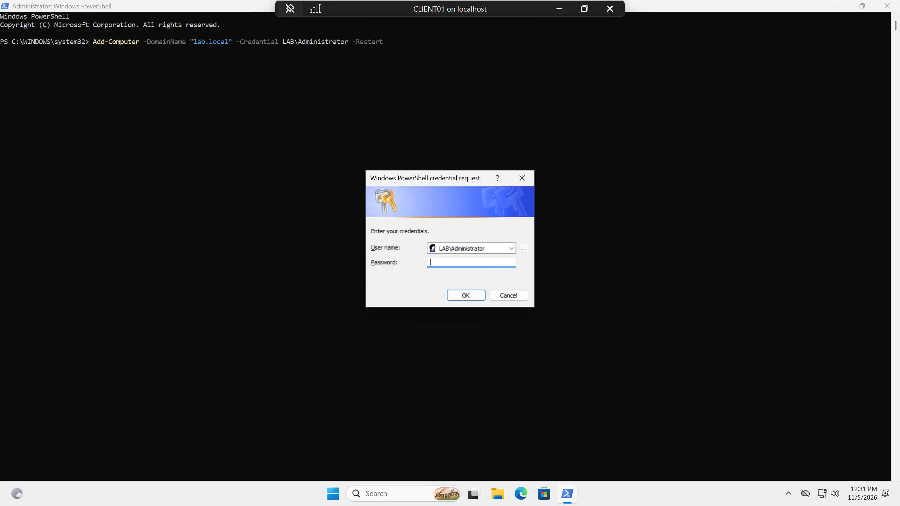
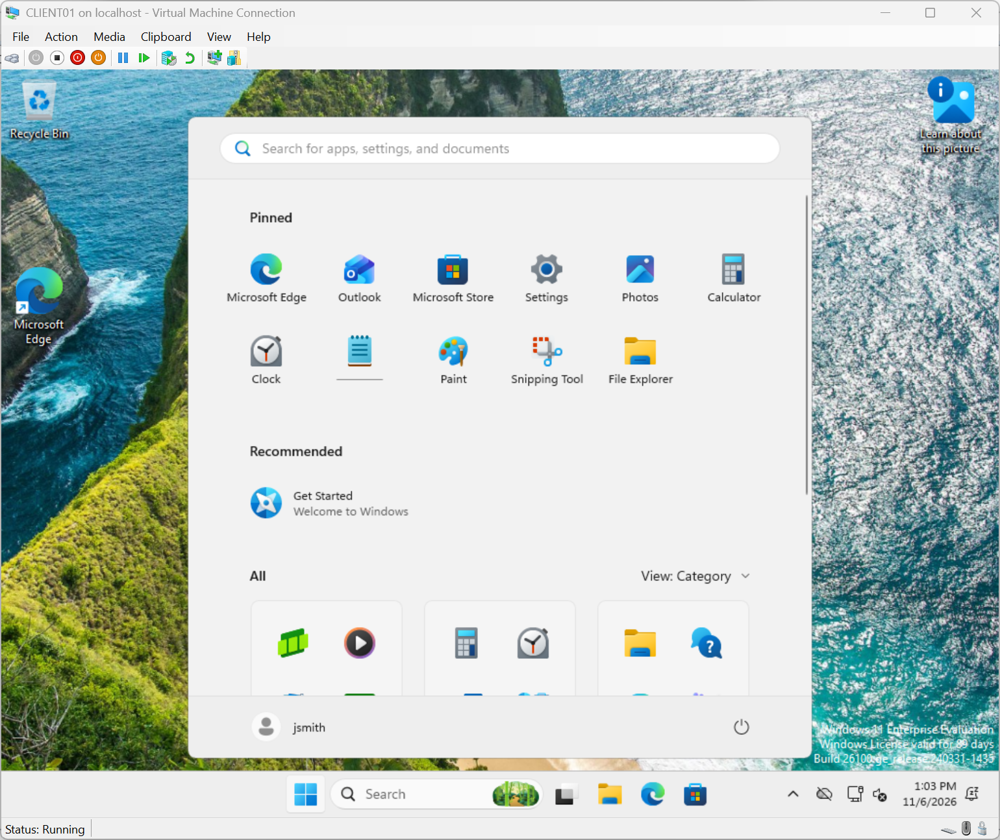

# Active Directory Home Lab
*Hands on Windows Server lab for IT support and systems administration practice*

**Tech Stack:** Windows Server 2025 • Active Directory • DNS • Hyper-V • PowerShell • Windows 11


## Overview
This lab recreates a small company network so I can practice the day to day work of an **IT support** or **junior systems administrator** role. I built a domain controller and a domain joined workstation in Hyper-V, then set up the users, groups, and OUs a help desk would manage.

Each phase is documented with the **commands I ran, screenshots, the issues I hit, and how I fixed them**.

> **Status:** Phases 1 to 4 are complete. Group Policy, account lockout, and security event logging are next.

## Lab Topology

```
Windows 11 Pro host (Hyper-V)
  │
  └── LabNAT internal switch   192.168.50.0/24   (NAT gateway 192.168.50.1)
        │
        ├── DC01       Windows Server 2025      192.168.50.10    Domain controller + DNS for lab.local
        │
        └── CLIENT01   Windows 11 Enterprise    192.168.50.20    Domain joined workstation (DNS → DC01)
```

| VM | OS | vCPU / RAM / Disk | Role |
|---|---|---|---|
| **DC01** | Windows Server 2025 Standard (Desktop Experience) | 2 / 4 GB / 60 GB | Domain controller and DNS server for `lab.local` |
| **CLIENT01** | Windows 11 Enterprise | 2 / 6 GB / 80 GB (virtual TPM) | Domain joined client, acts like a company laptop |

## In Action

<p align="center">
  
</p>
<p align="center">
  <em>Department OUs, security groups, and users in Active Directory Users and Computers.</em>
</p>

| Joining CLIENT01 to `lab.local` | Logged in to CLIENT01 as domain user `jsmith` |
|---|---|
|  |  |

## Phases

| # | Phase | What I Did | Doc |
|---|---|---|---|
| 1 | **Setup** | Enabled Hyper-V and built an isolated NAT lab network | [View](docs/01-setup_1.md) |
| 2 | **Domain Controller** | Built DC01, gave it a static IP, and promoted it to the first DC of `lab.local` | [View](docs/02-domain-controller_1.md) |
| 3 | **Client Join** | Built CLIENT01, pointed its DNS to DC01, and joined it to the domain | [View](docs/03-client-join.md) |
| 4 | **Users, OUs, and Groups** | Created department OUs and security groups, added users by hand and in bulk with PowerShell | [View](docs/04-users-and-ous.md) |

## Troubleshooting Highlights
- **Corrupted component store blocked Hyper-V:** Traced error `0x80073712` through `dism.log` and `CBS.log` to corrupt Hyper-V manifests, then repaired the component store. ([Phase 1](docs/01-setup_1.md#issues--fixes))
- **`Set-VMFirmware` type conversion error:** Found a duplicate DC01 VM I had accidentally created on the wrong drive, identified it by VM ID, and removed it with its leftover files. ([Phase 2](docs/02-domain-controller_1.md#issues--fixes))
- **Bulk import created disabled accounts:** The starting password failed the default domain password policy. Checked it with `Get-ADDefaultDomainPasswordPolicy`, removed only the CSV users, and reran the script. ([Phase 4](docs/04-users-and-ous.md#issues--fixes))
- **Script reported false successes:** `New-ADUser` errors were non-terminating, so the loop kept going and printed "Created." Added `-ErrorAction Stop` and a `try/catch` that reports the failure and cleans up the half-created account. ([Phase 4](docs/04-users-and-ous.md#issues--fixes))

## Scripts
- **[`bulk-create-users.ps1`](scripts/bulk-create-users.ps1):** Creates users from a CSV, places each one in their department OU, adds them to the matching security group, skips existing users, forces a password change at first login, and cleans up any account that fails.
- **[`users.csv`](scripts/users.csv):** Sample input file.

## Skills Practiced
- **Active Directory:** Domain controller promotion, OUs, security groups, user and computer accounts
- **Networking:** Static IPs, internal NAT switch, DNS for a local domain
- **Automation:** PowerShell scripting with CSV input and error handling
- **Troubleshooting:** DISM, SFC, `CBS.log`, Hyper-V cmdlets, domain password policy

## Next Up
- [ ] **Group Policy:** Link GPOs to the department and Workstations OUs
- [ ] **Account policies:** Password and account lockout settings
- [ ] **Logging:** Windows event logging and investigating failed logins
- [ ] **Security scenario:** A least privilege or account compromise exercise
- [ ] **Write up:** What I observed and how I would improve the environment
