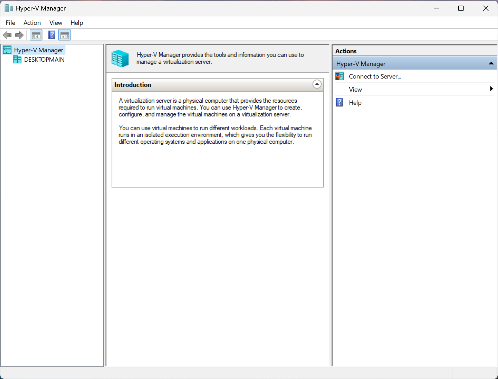
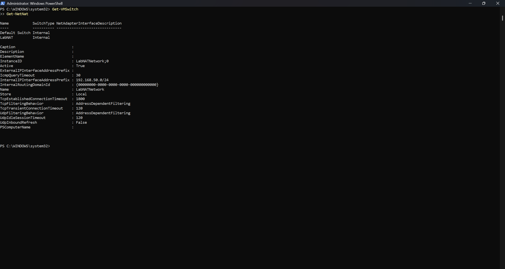

# Phase 1: Setup (Hyper-V and Lab Network)

## Goal
Enable Hyper-V on my Windows 11 Pro PC, download the Windows Server 2025 and Windows 11 Enterprise ISOs, and create a private lab network (192.168.50.0/24) that the VMs can use to reach the internet.

## Steps

### 1. Enable Hyper-V
```powershell
Enable-WindowsOptionalFeature -Online -FeatureName Microsoft-Hyper-V -All
```
This failed at first (see [Issues & Fixes](#issues--fixes)). After the fix, I ran the enable command again and then restarted the machine.

- Booted up Hyper-V Manager



### 2. Prepare folders and ISOs
- Created folders `Active_Directory\ISOs` and `Active_Directory\VMs` on a separate SSD
- Went to the Microsoft Evaluation Center to download the Windows 11 Enterprise ISO and Windows Server 2025, saving both ISOs in the `\ISOs` folder
- Planned to set the lab network as 192.168.50.0/24, running `ipconfig` to confirm my home network did not already use this range

### 3. Create the lab network
```powershell
New-VMSwitch -SwitchName "LabNAT" -SwitchType Internal
```
Creation of a virtual switch that only exists inside of the local machine.

```powershell
New-NetIPAddress -IPAddress 192.168.50.1 -PrefixLength 24 -InterfaceAlias "vEthernet (LabNAT)"
```
Assigns the IP 192.168.50.1 to the virtual adapter (vEthernet LabNAT) of the local machine. This will act as the router for the virtual network.

```powershell
New-NetNat -Name "LabNATNetwork" -InternalIPInterfaceAddressPrefix 192.168.50.0/24
```
Enables NAT, or Network Address Translation. This allows multiple devices within a private local network to share one public IP address when accessing the internet.

## Verification
To ensure the network was created, I ran:
```powershell
Get-VMSwitch
Get-NetNat
```
This gave the following important output to show it was active:
```
InstanceID                       : LabNATNetwork;0
Active                           : True
InternalIPInterfaceAddressPrefix : 192.168.50.0/24
```


## Issues & Fixes

**Issue:** Enabling Hyper-V failed with a problem with the component store being corrupt.

**Diagnosis:**
- Ran DISM CheckHealth/ScanHealth/RestoreHealth and SFC. SFC reported that it repaired the files, but the error persisted
- `dism.log` showed error `0x80073712`
- `CBS.log` showed `CorruptManifest` errors for the Hyper-V components (HyperV-Networking, HyperV-Compute-Host-Containers)
- ScanHealth missed them because Hyper-V wasn't installed yet

**Fix:** A repair reinstall of Windows fixed this issue. This was done in Settings > System > Recovery > Fix problems using Windows Update, and it keeps files and apps that are installed.

## What I Learned

- ScanHealth looks for files that are corrupted, however, it checks and prioritizes packages that are installed. In this case, Hyper-V was not installed, so it was missed by ScanHealth and logged in the CBS.log. Although the Hyper-V feature was not active, the corruption blocked me from being able to successfully install or enable Hyper-V without forcing Windows to repair its entire component store.

