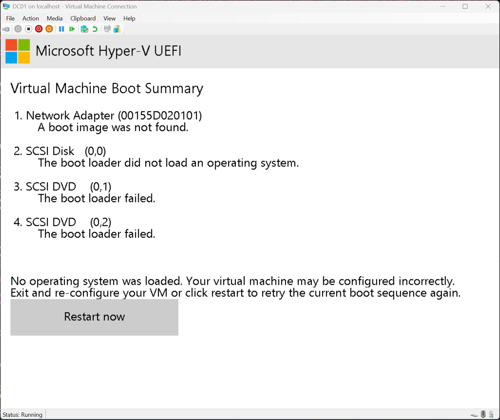
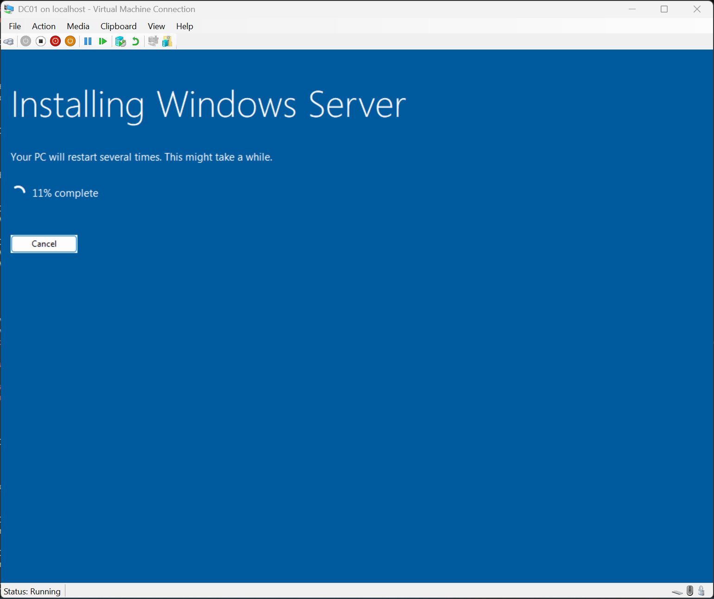
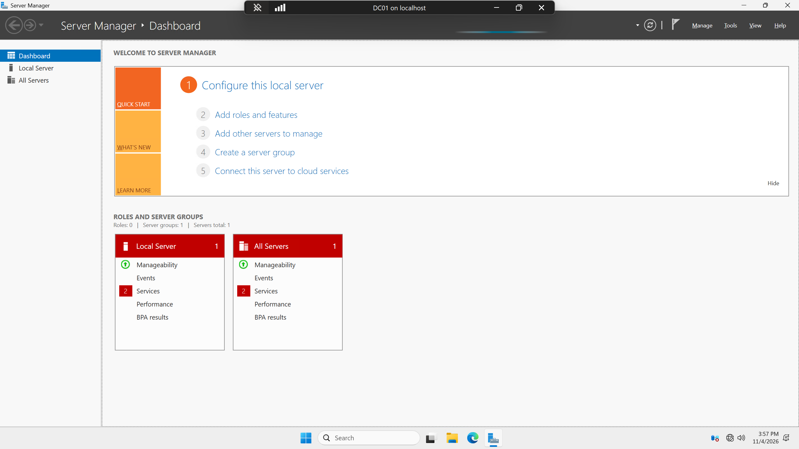
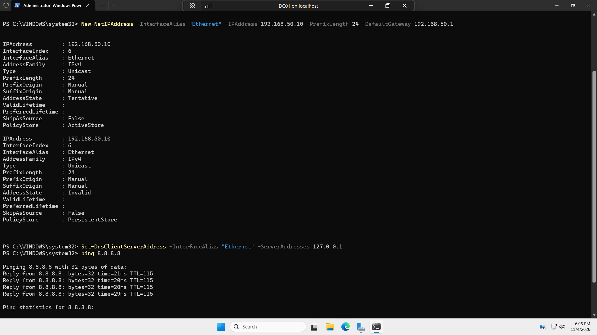
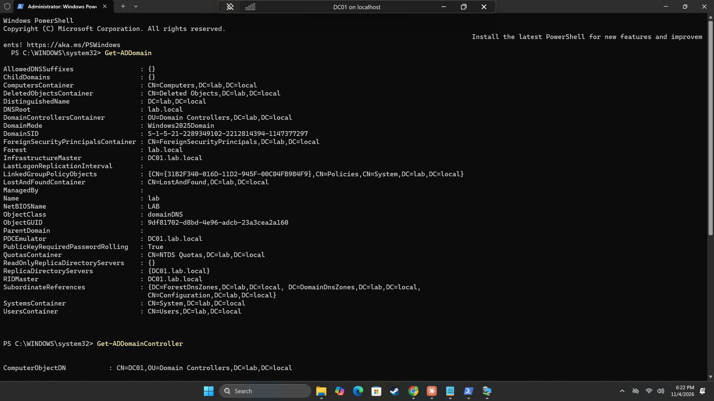
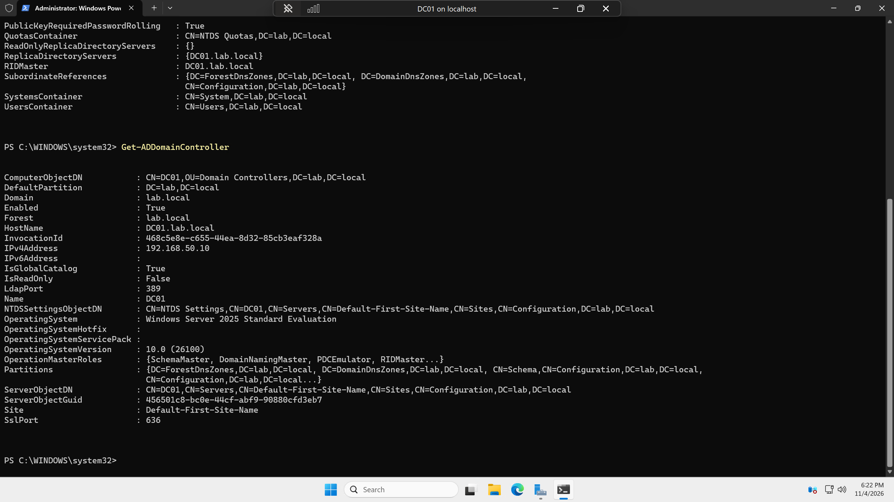
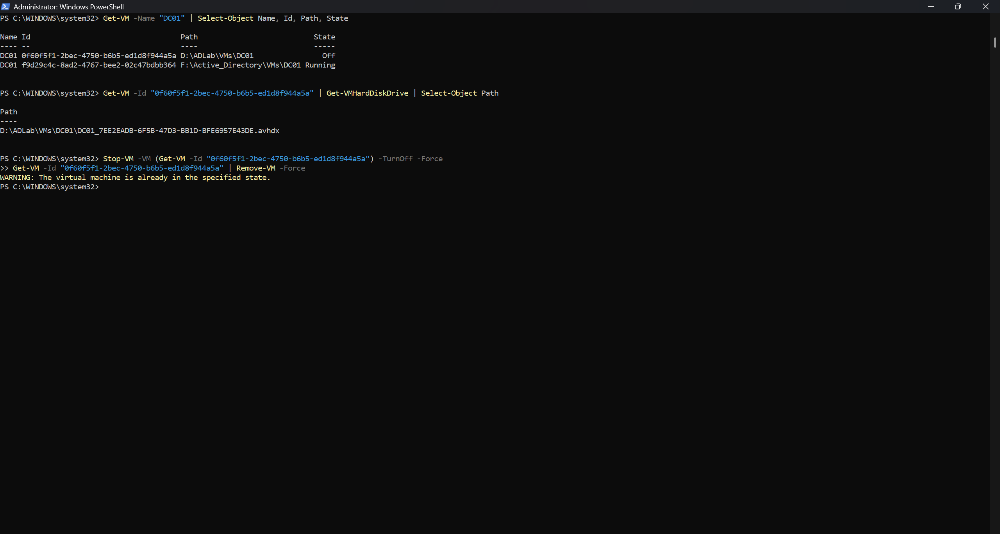

# Phase 2: Domain Controller (DC01)

## Goal
Create the DC01 virtual machine, install Windows Server 2025, give it a static IP and a real name, and promote it to the first domain controller of a new domain, lab.local.

## Steps

### 1. Create the VM
```powershell
Get-ChildItem F:\Active_Directory\ISOs
```
Lists out ISO names within the `\ISOs` folder.

```powershell
New-VM -Name "DC01" -Generation 2 -MemoryStartupBytes 4GB -Path "F:\Active_Directory\VMs" -NewVHDPath "F:\Active_Directory\VMs\DC01\DC01.vhdx" -NewVHDSizeBytes 60GB -SwitchName "LabNAT"
```
Names the VM "DC01" and sets it up with 4GB of RAM and 60GB of disk space, saved to the VMs folder.

```powershell
Set-VMProcessor -VMName "DC01" -Count 2
```
2 CPUs.

```powershell
Set-VMMemory -VMName "DC01" -DynamicMemoryEnabled $false
```
We disable dynamic memory so that DC01 will have exactly 4GB of RAM all of the time. If this setting was on, Hyper-V would monitor how much it's actually using and would adjust, taking some RAM back for other VMs to use.

```powershell
Add-VMDvdDrive -VMName "DC01" -Path "F:\Active_Directory\ISOs\Windows_Server_2025.iso"
```
Path to the saved ISO.

```powershell
Set-VMFirmware -VMName "DC01" -FirstBootDevice (Get-VMDvdDrive -VMName "DC01")
```
Sets the VM's UEFI boot order to start from the Server ISO. This command returned an error (see [Issues & Fixes](#issues--fixes)).

Next I booted up the VM and connected to it:
```powershell
Start-VM -Name "DC01"
vmconnect localhost DC01
```


### 2. Install Windows Server
- Once I had the VM up and running, I needed to reset it in order to begin with the Windows Server setup
- When selecting an image, I chose **Windows Server 2025 Standard Evaluation (Desktop Experience)** as it allows for a graphical interface
- For the install location, I selected Disk 0 with 60GB



- Set the Admin password. This acts as a lab-only password and is not included in the documentation
- Successfully launched the VM



- Created a checkpoint so I can go back if any errors occur in the future:
```powershell
Checkpoint-VM -Name "DC01" -SnapshotName "Fresh Server install"
```

### 3. Give DC01 a static IP and a real name
Found the network adapter's name (in my case it was "Ethernet"):
```powershell
Get-NetAdapter
```

Set a static IP:
```powershell
New-NetIPAddress -InterfaceAlias "Ethernet" -IPAddress 192.168.50.10 -PrefixLength 24 -DefaultGateway 192.168.50.1
Set-DnsClientServerAddress -InterfaceAlias "Ethernet" -ServerAddresses 127.0.0.1
```
This VM will act as our domain controller, authenticating the users and their authorizations. We set it to a fixed address so that every other machine within the local network can always find it.

**Why DNS points to itself:** DNS (Domain Name System) will translate names (google.com, DC01, youtube.com, etc.) into IP addresses, almost as if it was a lookup table. Pi-hole already runs as a DNS server, as it will answer devices on a network for the IP address for something like google.com, and it will block malware or ads or it passes the question on to an upstream server on the internet and returns an answer. DC01 will know the domains within the lab (i.e. lab.local, DC01.lab.local, CLIENT01.lab.local, etc.) but will not know public IP addresses like google.com, so it asks the internet and passes these answers back to the clients within the Active Directory. Without a Domain Name System, when a new device tries to join the domain, it will be unable to join or log in, as it needs a response from the DNS. When DC01 is instructed to look something up, it points to itself to check its own records for the correct domain in question.

Renamed the Windows computer inside of the VM, followed by a restart:
```powershell
Rename-Computer -NewName "DC01" -Restart
```

### 4. Promote DC01 to a domain controller
Installed the Active Directory role in PowerShell (on the virtual machine):
```powershell
Install-WindowsFeature AD-Domain-Services -IncludeManagementTools
```

Created the domain:
```powershell
Install-ADDSForest -DomainName "lab.local" -DomainNetbiosName "LAB" -InstallDns
```
A forest acts as a top-level container within Active Directory. It can hold only one domain or multiple domains that all trust each other. In this case, we only have one domain, but in a larger company a forest can contain multiple domains. This command creates the forest, sets the domain name to lab.local, and makes DC01 its first domain controller.

> Note: .local is fine in this lab, but a real company would typically use a subdomain of a domain it owns.

The system installed and restarted. After restarting, I signed in with the username `LAB\Administrator` and the password from before.

Took another checkpoint (on the local machine):
```powershell
Checkpoint-VM -Name "DC01" -SnapshotName "DC promoted"
```

## Verification
Tested the connection after setting the static IP:
```powershell
ping 8.8.8.8
```


Ran the following commands to ensure the domain was set up properly:
```powershell
Get-ADDomain
Get-ADDomainController
```



## Issues & Fixes

**Issue:** `Set-VMFirmware` returned an error: `Cannot convert 'System.Object[]' to the type 'Microsoft.HyperV.PowerShell.VMComponentObject'`

**Diagnosis:** Originally I believed it was with trying to convert the types of arguments I was using, but I was also not sure what this line did. Turns out I had accidentally saved it to the wrong drive that did not have enough space for the virtual machine. The error I received was expecting only one DVD drive for the VM, but because I had originally created a VM in the wrong drive, 2 were showing up, which is what caused the error.

**Fix:** Ran the following command to find out where both VMs were:
```powershell
Get-VM -Name "DC01" | Select-Object Name, Id, Path, State
```
With the VM IDs, I could delete and remove the incorrect VM using the following commands:
```powershell
Get-VM -Id "<WRONG-VM-ID>" | Get-VMHardDiskDrive | Select-Object Path
Stop-VM -VM (Get-VM -Id "<WRONG-VM-ID>") -TurnOff -Force
Get-VM -Id "<WRONG-VM-ID>" | Remove-VM -Force
```
Also made sure to delete the leftover files on the D drive.



## What I Learned

- The point of a DNS and how it can be used not only in a local domain, but also across the internet. I gained a helpful explanation of how devices on the same network can find each other by name as well as outside of the local network.
- Active directory containers and an active directory forest. Important to note that multiple domains can exist within a forest and every domain within the forest all trust each other and can be given access each other's resources.
- The importance of setting up your domain controller to act as a DNS server. It can look through its own domain to help communication between local devices as well as forwarding lookups to the internet and returning the answer back to its clients.
