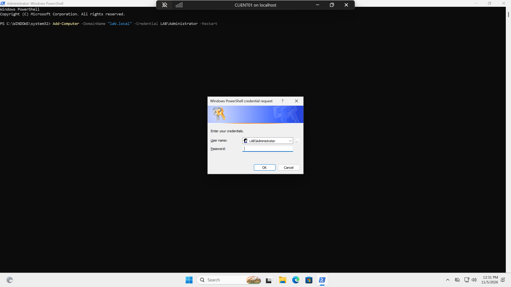
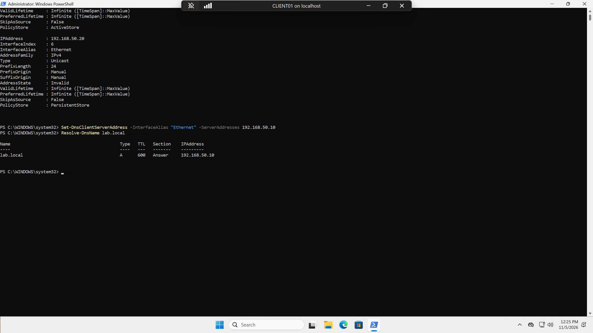
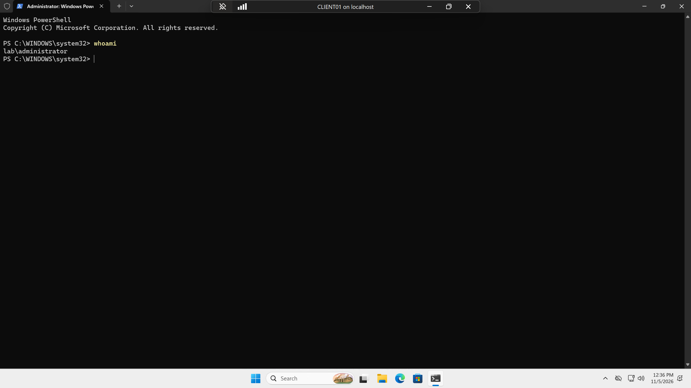
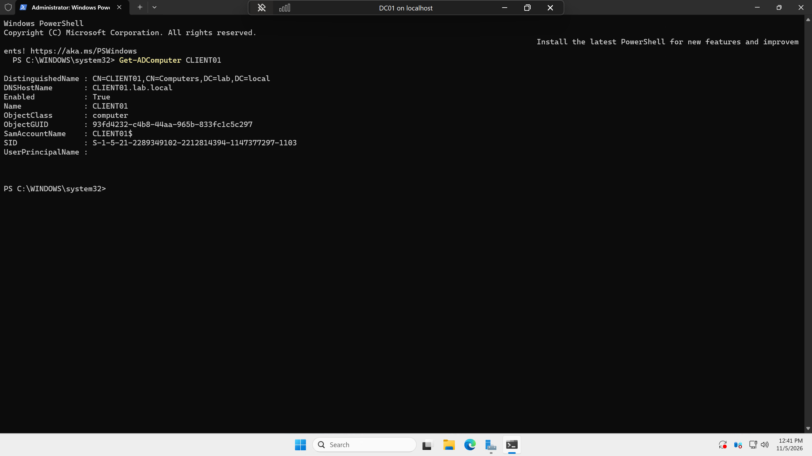

# Phase 3: Client (CLIENT01) and Domain Join

## Goal
Create a Windows 11 client VM (CLIENT01), point its DNS to DC01, and join it to the lab.local domain like a work laptop.

## Steps

### 1. Create CLIENT01
```powershell
New-VM -Name "CLIENT01" -Generation 2 -MemoryStartupBytes 6GB -Path "F:\Active_Directory\VMs" -NewVHDPath "F:\Active_Directory\VMs\CLIENT01\CLIENT01.vhdx" -NewVHDSizeBytes 80GB -SwitchName "LabNAT"
```
Creation of CLIENT01 with 6GB of RAM and 80GB of storage.

```powershell
Set-VMProcessor -VMName "CLIENT01" -Count 2
Set-VMMemory -VMName "CLIENT01" -DynamicMemoryEnabled $false
```
Set CPUs to 2.

```powershell
Set-VMKeyProtector -VMName "CLIENT01" -NewLocalKeyProtector
Enable-VMTPM -VMName "CLIENT01"
```
Windows 11 requires a TPM, or a Trusted Platform Module. It securely stores cryptographic keys, PINs, and biometric data.

```powershell
Add-VMDvdDrive -VMName "CLIENT01" -Path "F:\Active_Directory\ISOs\Windows_11_Enterprise.iso"
```

To avoid a similar problem as before, I first checked for one DVD drive before setting the boot order:
```powershell
Get-VMDvdDrive -VMName "CLIENT01"
Set-VMFirmware -VMName "CLIENT01" -FirstBootDevice (Get-VMDvdDrive -VMName "CLIENT01")
```

Started up the VM and connected:
```powershell
Start-VM -Name "CLIENT01"
vmconnect localhost CLIENT01
```

### 2. Install Windows 11
- Custom install onto the 80GB disk
- Once installed, instead of logging in with a Microsoft account, I selected Domain join to create a local account
- Created another checkpoint on the local machine:
```powershell
Checkpoint-VM -Name "CLIENT01" -SnapshotName "Fresh Win11 install"
```

### 3. Network settings
Set up the network settings for CLIENT01 within the VM:
```powershell
Get-NetAdapter
New-NetIPAddress -InterfaceAlias "Ethernet" -IPAddress 192.168.50.20 -PrefixLength 24 -DefaultGateway 192.168.50.1
Set-DnsClientServerAddress -InterfaceAlias "Ethernet" -ServerAddresses 192.168.50.10
```

Renamed and restarted the VM:
```powershell
Rename-Computer -NewName "CLIENT01" -Restart
```

### 4. Join the domain
Opened PowerShell again on the VM and joined the domain:
```powershell
Add-Computer -DomainName "lab.local" -Credential LAB\Administrator -Restart
```


Once restarted, I signed in as the domain user by selecting Other user and entering `LAB\Administrator` to verify the VM is a part of the domain.

Took another checkpoint on the local machine:
```powershell
Checkpoint-VM -Name "CLIENT01" -SnapshotName "Domain joined"
```

## Verification
Tested that DNS finds the domain:
```powershell
Resolve-DnsName lab.local
```


In PowerShell on CLIENT01, used `whoami` to verify `lab\administrator`:


On DC01, also verified that CLIENT01 appears in the domain:
```powershell
Get-ADComputer CLIENT01
```


## Issues & Fixes
- No issues in this phase.

## What I Learned

- When CLIENT01 joined the domain, Active Directory created a computer account for it within the Computers container, which is why the domain controller could find it. The domain account is able to log into every machine that is within the domain, not only the one it was created on.
- Trusted Platform Module is required by Windows 11 and in this case a virtual TPM is created.
- CLIENT01 could only find and join the domain lab.local because its DNS points back to DC01 (192.168.50.10).
