# Phase 4: Users, OUs, and Groups

## Goal
Build a simple company structure in Active Directory with OUs for each department, create security groups, add a user by hand, and then create users in bulk from a CSV file with a PowerShell script.

## Steps

### 1. Create Organizational Units
OUs can be used for organizing AD objects. Unlike the default containers, we can apply Group Policy to the OUs.
```powershell
New-ADOrganizationalUnit -Name "Lab" -Path "DC=lab,DC=local"
New-ADOrganizationalUnit -Name "IT" -Path "OU=Lab,DC=lab,DC=local"
New-ADOrganizationalUnit -Name "Sales" -Path "OU=Lab,DC=lab,DC=local"
New-ADOrganizationalUnit -Name "HR" -Path "OU=Lab,DC=lab,DC=local"
New-ADOrganizationalUnit -Name "Groups" -Path "OU=Lab,DC=lab,DC=local"
New-ADOrganizationalUnit -Name "Workstations" -Path "OU=Lab,DC=lab,DC=local"
```
Here we are creating the different OUs and telling AD where to put each. Each is being saved inside of the Lab OU, inside of the lab.local domain. This formatting is known as a distinguished name, identifying an object's exact location within the directory hierarchy. OU = Organizational Unit (Lab), DC = Domain Component (lab.local). The "IT", "Sales", "HR", "Groups", and "Workstations" OUs all reside within the "Lab" OU.

### 2. Create department groups
We now want to create groups for each department so we can grant access and apply Group Policy. This makes it possible to give users that are part of a group access to a shared resource by just allowing the group access, instead of each individual user separately.
```powershell
New-ADGroup -Name "IT-Staff" -GroupScope Global -GroupCategory Security -Path "OU=Groups,OU=Lab,DC=lab,DC=local"
New-ADGroup -Name "Sales-Staff" -GroupScope Global -GroupCategory Security -Path "OU=Groups,OU=Lab,DC=lab,DC=local"
New-ADGroup -Name "HR-Staff" -GroupScope Global -GroupCategory Security -Path "OU=Groups,OU=Lab,DC=lab,DC=local"
```
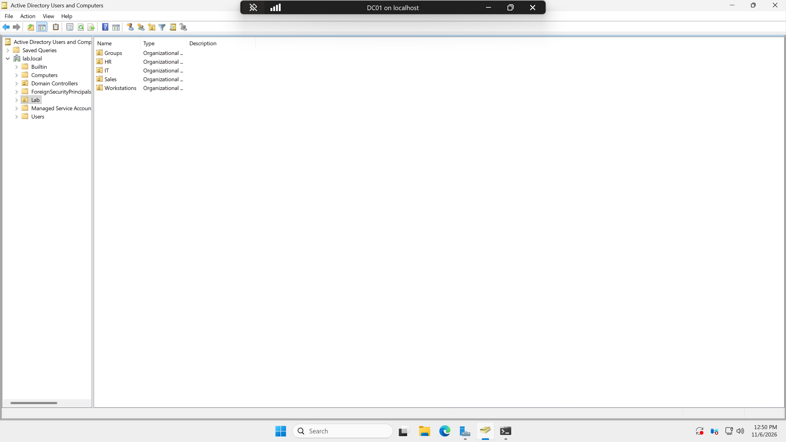

### 3. Create a user by hand
```powershell
New-ADUser -Name "Jordan Smith" -GivenName "Jordan" -Surname "Smith" -SamAccountName "jsmith" -UserPrincipalName "jsmith@lab.local" -Path "OU=Sales,OU=Lab,DC=lab,DC=local" -AccountPassword (Read-Host -AsSecureString "Password") -Enabled $true -ChangePasswordAtLogon $true
Add-ADGroupMember -Identity "Sales-Staff" -Members "jsmith"
```
In these lines, we create the user "Jordan Smith" with the username "jsmith", adding him as an object within the "Sales" OU. As a new user, at their first login, they will be prompted to create a new login password. Finally, we add "jsmith" as a member of "Sales-Staff".

> Note: This part will prompt for a password that will be used at the user's first login.

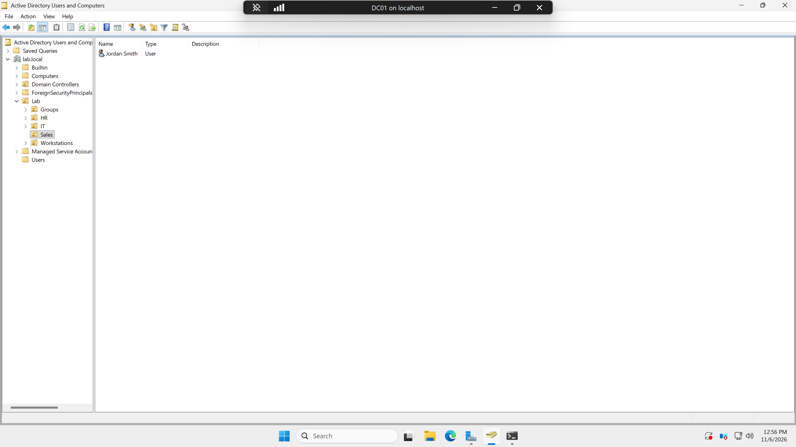

### 4. Move CLIENT01 into the Workstations OU
Finally, we move CLIENT01 into the "Workstations" OU so Group Policy can target it later.
```powershell
Get-ADComputer CLIENT01 | Move-ADObject -TargetPath "OU=Workstations,OU=Lab,DC=lab,DC=local"
```

### 5. Bulk creation of users with a script
In this next step, we use a Windows PowerShell script that takes the first name, last name, and department of each user, automatically creates a username, and sorts them into their respective OUs and groups depending on their department value. The script is [`bulk-create-users.ps1`](../scripts/bulk-create-users.ps1) in the `scripts` folder, with a sample [`users.csv`](../scripts/users.csv) file that holds each user's data.

Here are the steps to copy the files into the domain controller from the local machine:
```powershell
Enable-VMIntegrationService -VMName "DC01" -Name "Guest Service Interface"
Copy-VMFile -Name "DC01" -SourcePath "F:\Active_Directory\active-directory-homelab\scripts\bulk-create-users.ps1" -DestinationPath "C:\Scripts\bulk-create-users.ps1" -CreateFullPath -FileSource Host
Copy-VMFile -Name "DC01" -SourcePath "F:\Active_Directory\active-directory-homelab\scripts\users.csv" -DestinationPath "C:\Scripts\users.csv" -CreateFullPath -FileSource Host
```

Next, ran the script on the VM:
```powershell
cd C:\Scripts
.\bulk-create-users.ps1
```
It will prompt for a starting password for each user's first login. Just as before, they will be prompted to enter a new password.

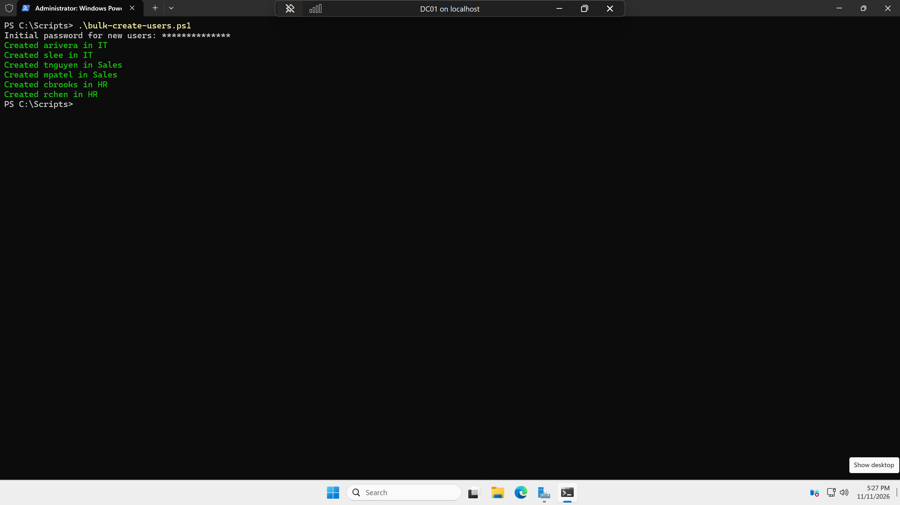

Ran the script again to ensure that created users will not be recreated:

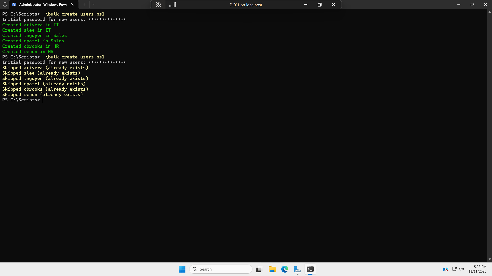

## Verification
To ensure "jsmith" had been added, I logged in on CLIENT01 and was prompted to change the password.

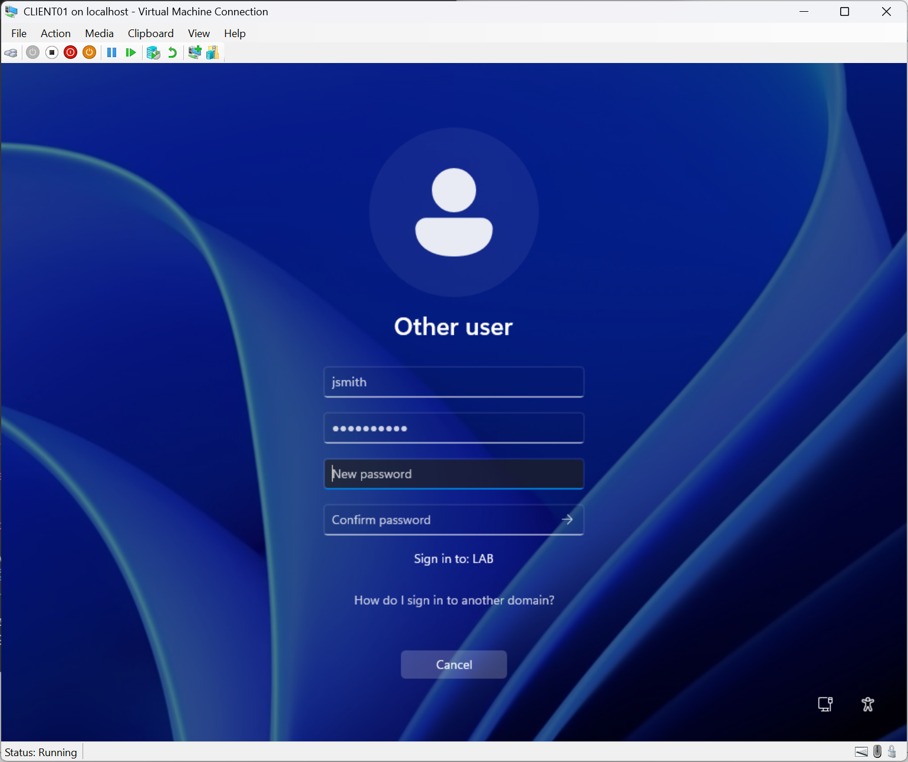
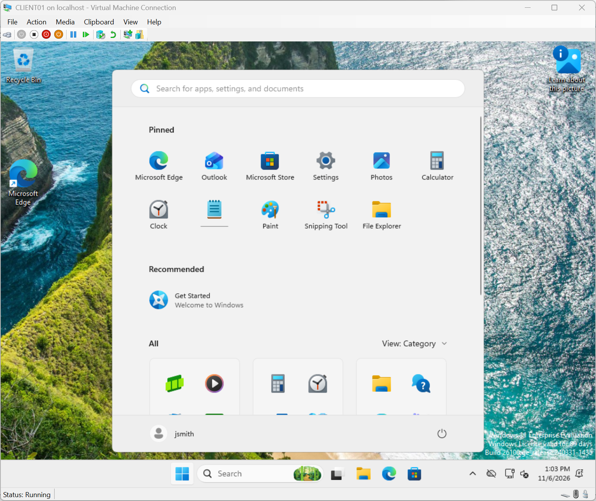

Further verification on DC01:
```powershell
Get-ADUser jsmith -Properties MemberOf | Select-Object Name, SamAccountName, DistinguishedName, MemberOf
Get-ADGroupMember "Sales-Staff"
```
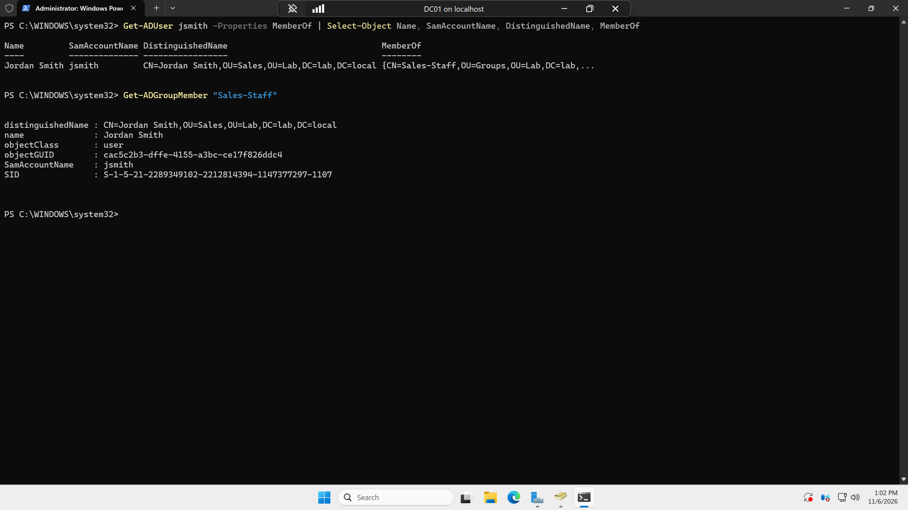

Verified the bulk-created users were added into AD:
```powershell
Get-ADUser -Filter * -SearchBase "OU=Lab,DC=lab,DC=local" | Select-Object Name, SamAccountName, DistinguishedName
Get-ADGroupMember "IT-Staff"
Get-ADGroupMember "Sales-Staff"
Get-ADGroupMember "HR-Staff"
```
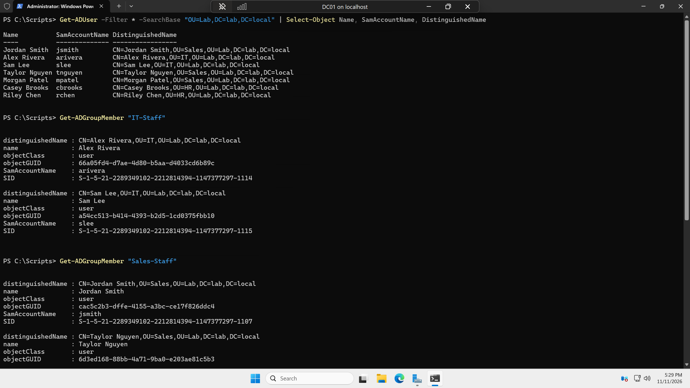
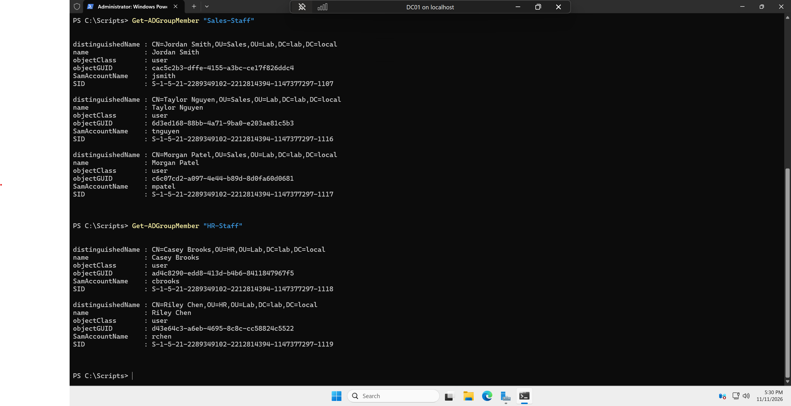

Finally, a look from within ADUC (Active Directory Users and Computers):


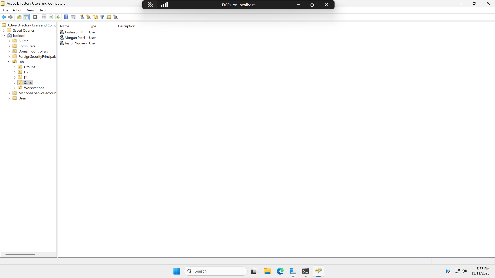

## Issues & Fixes

**Issue:** The script failed with `The password does not meet the length, complexity, or history requirement of the domain.`

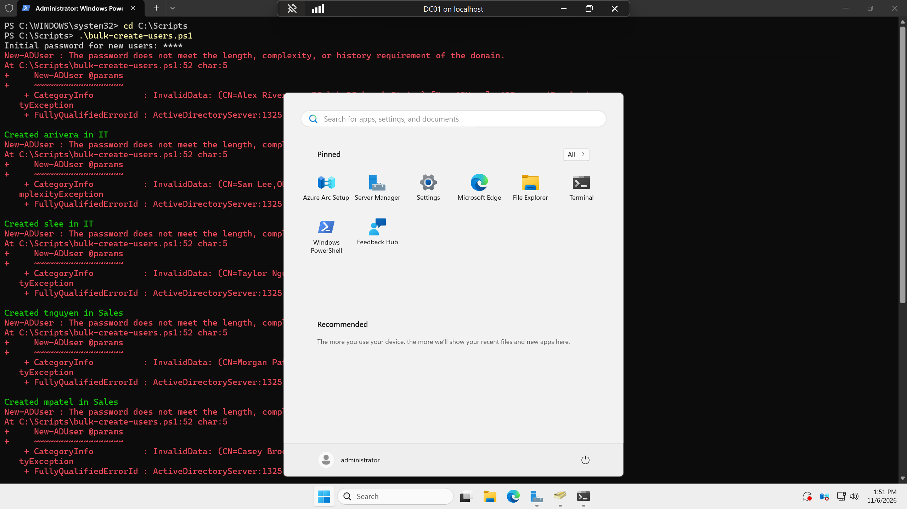

**Diagnosis:** I ran into an issue with the password not being complex enough. I looked up the default domain password policy with the following command:
```powershell
Get-ADDefaultDomainPasswordPolicy
```
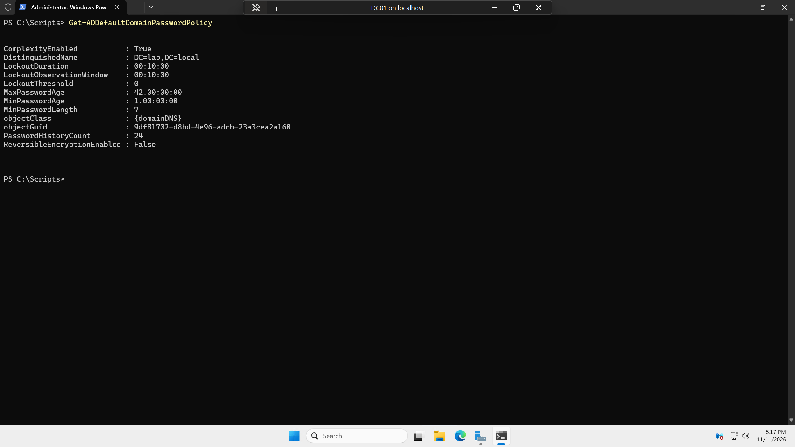

The accounts were still created, just in a disabled state, because the password was not complex enough. To make sure I did not delete the jsmith user that had already been created, I checked which users were enabled:
```powershell
Get-ADUser -Filter * -SearchBase "OU=Lab,DC=lab,DC=local" | Select-Object Name, SamAccountName, Enabled
```
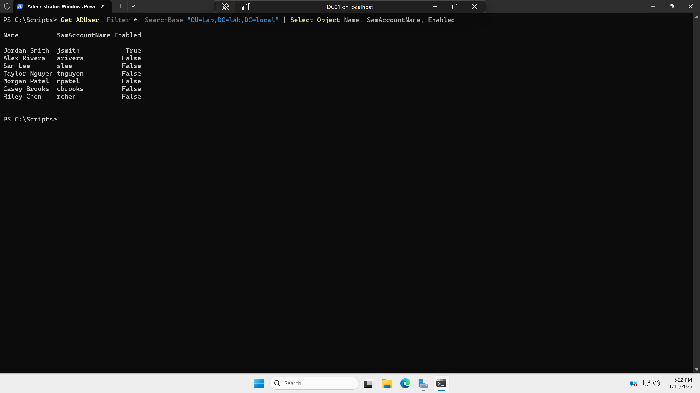

**Fix:** Using the following command, I removed only the users from the CSV:
```powershell
Import-Csv C:\Scripts\users.csv | ForEach-Object {
    $u = ($_.FirstName.Substring(0,1) + $_.LastName).ToLower()
    Remove-ADUser -Identity $u -Confirm:$false
}
```
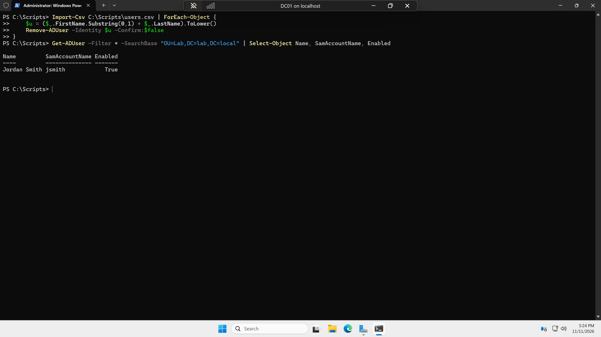

Then I ran the script again, this time making sure to meet the requirements of the default domain password policy.

<!-- TODO: if you update the script, add a short second issue here about the false "Created" message and the try/catch fix -->

## What I Learned

- You are able to allow individuals access to different resources by assigning them to a shared group rather than just creating these rules for each user one by one. 
- The difference and purpose of an OU and a group. An OU is where an object lives, and group policies that are linked to that OU will affect the users and devices within. A group is used in order to declare what resources a group of users and computers has access to. Example a folder, application, or device such as a printer. 
